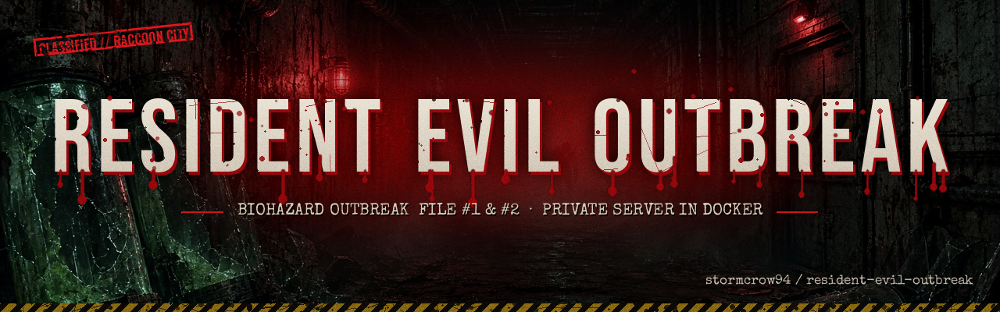

<p align="center">
  
</p>

<p align="center">
  
  
  
  
  
  
  
</p>

# Resident Evil / Biohazard: Outbreak — Docker server

A single Docker image that brings the long-gone online services for **Biohazard Outbreak File #1 and File #2** (PlayStation 2) back to life: a DNAS replacement, the game's web front-end and the Java lobby/game servers, all wired together and ready for **LAN or internet (WAN) play** with PCSX2.

This repository is a fork and extension of **[corbin-zip/bioserver-docker](https://github.com/corbin-zip/bioserver-docker)** (original author: **corbin-zip**). It adds public WAN support through a `PUBLIC_IP` variable, a `docker-compose.yml` and deployment notes.

> [!CAUTION]
> This stack **intentionally** runs OpenSSL 1.0.2 with SSLv2/SSLv3 and weak ciphers enabled, because the PS2 DNAS client cannot speak modern TLS. Run it on a dedicated host/VM, expose only the ports listed below and never reuse that Apache/OpenSSL for anything else. See [Security notes](#security-notes).

## Contents

- [What's inside](#whats-inside)
- [Requirements](#requirements)
- [Quick start (Docker Compose)](#quick-start-docker-compose)
- [Manual Docker (without Compose)](#manual-docker-without-compose)
- [Connecting players](#connecting-players)
- [Ports](#ports)
- [How it works](#how-it-works)
- [Repository structure](#repository-structure)
- [Operations](#operations)
- [Troubleshooting](#troubleshooting)
- [Security notes](#security-notes)
- [Contributing](#contributing)
- [Credits, license and disclaimer](#credits-license-and-disclaimer)

## What's inside

Everything is built from the [`Dockerfile`](Dockerfile) at image build time (final image is roughly **~2.25 GB**):

| Component | Version / source | Role |
|---|---|---|
| Base image | `debian:bullseye-slim` | Provides PHP 7.4 and OpenJDK 17 packages |
| OpenSSL | 1.0.2q, compiled with `enable-weak-ssl-ciphers enable-ssl2 enable-ssl3` | TLS the PS2 DNAS client understands |
| Apache httpd | 2.4.56 + APR 1.7.2 / APR-util 1.6.3 (from `archive.apache.org`) | Serves DNAS on `443` and the game web pages |
| PHP-FPM | 7.4 | Runs the DNAS and game portal PHP |
| dnsmasq | Debian package | Answers the game's DNS lookups with your server IP |
| MariaDB | Debian package | `bioserver` databases for File #1 and File #2 |
| DNASrep | cloned from [corbin-zip/DNASrep](https://github.com/corbin-zip/DNASrep) | DNAS replacement |
| bioserver | cloned from [corbin-zip/bioserver](https://github.com/corbin-zip/bioserver) | File #1 and File #2 servers (Java), compiled with MySQL Connector/J 8.0.32 |

## Requirements

**Server**

- Linux host (or VM) with **Docker** and the **Docker Compose plugin** (`docker compose`). x86_64 is what the Dockerfile targets (it edits `/etc/ld.so.conf.d/x86_64-linux-gnu.conf`).
- ~3 GB of free disk for the build, plus internet access during `docker compose build` (sources are downloaded from openssl.org, archive.apache.org, dev.mysql.com and GitHub).
- Free host ports `53/udp`, `80`, `443`, `8200`, `8300`, `8590`, `8690` (see [Ports](#ports)).
- For internet play: a public IP and the ability to forward ports on your router.

**Players**

- A legitimately owned copy of Biohazard Outbreak File #1 and/or File #2 running on PCSX2 with networking enabled (a PS2 with a network adapter follows the same DNS setup).
- The ability to set the console/emulator **primary DNS** to your server IP.

## Quick start (Docker Compose)

1. Clone the repo:

   ```bash
   git clone https://github.com/stormcrow94/resident-evil-outbreak.git
   cd resident-evil-outbreak
   ```

2. Edit [`docker-compose.yml`](docker-compose.yml) and replace `YOUR_PUBLIC_IP` with the address players will use as DNS:
   - **Internet play:** your real **WAN** (public) IP.
   - **LAN only:** the LAN IP of the Docker host (e.g. `192.168.1.50`).

   The container refuses to start while the value is empty or still `YOUR_PUBLIC_IP`.

   > Docs use `203.0.113.42` as an example. It belongs to RFC 5737 TEST-NET-3, reserved for documentation, so it never points to a real server. Always use your own IP.

3. Build and start:

   ```bash
   docker compose build
   docker compose up -d
   docker logs -f bioserver
   ```

4. For internet play, forward the [ports](#ports) on your router to the Docker host.

5. Check DNS from another machine (replace the example IP):

   ```bash
   nslookup gate1.jp.dnas.playstation.org 203.0.113.42
   # expected answer: 203.0.113.42 (your PUBLIC_IP)
   ```

More details, including firewall notes, live in [`PUBLIC_DEPLOY_NOTES.txt`](PUBLIC_DEPLOY_NOTES.txt).

## Manual Docker (without Compose)

The entrypoint requires `PUBLIC_IP`, so pass it together with the published ports:

```bash
docker build -t bioserver-docker .
docker run -d --name bioserver --restart unless-stopped \
  -e PUBLIC_IP=203.0.113.42 \
  -p 53:53/udp -p 80:80 -p 443:443 \
  -p 8200:8200 -p 8200:8200/udp -p 8300:8300 -p 8300:8300/udp \
  -p 8590:8590 -p 8590:8590/udp -p 8690:8690 -p 8690:8690/udp \
  -v mysql_data:/var/lib/mysql \
  bioserver-docker
```

> The upstream instructions (`docker container create` / `start` without `-e PUBLIC_IP`) no longer work with this fork: the container exits with `ERROR: Set PUBLIC_IP ...`.

## Connecting players

1. In PCSX2 (or on the PS2 network settings), enable the network adapter and set the **primary DNS** to the server's `PUBLIC_IP`.
2. Start Biohazard Outbreak File #1 or File #2 and go online. The DNAS check and the game's login page are answered by this server.

No hosts-file edits are needed when DNS points to the server. dnsmasq only overrides `gate1.jp.dnas.playstation.org` and `www01.kddi-mmbb.jp` (see [`config/obcomsrv`](config/obcomsrv)); every other name is resolved upstream.

## Ports

| Port | Protocol | Used by |
|---|---|---|
| 53 | UDP | dnsmasq (game DNS) |
| 80 | TCP | Apache (HTTP) |
| 443 | TCP | Apache + OpenSSL 1.0.2 (DNAS) |
| 8200, 8300 | TCP + UDP | File #1 / File #2 game servers |
| 8590, 8690 | TCP + UDP | File #1 / File #2 game servers |

Only UDP is published for port 53: TCP/53 failed with "address already in use" on some hosts and plain DNS over UDP is enough for the game.

## How it works

On the **first start** of a container, [`config/entrypoint.sh`](config/entrypoint.sh):

1. Starts MariaDB (`mysqld_safe`) and waits 5 seconds.
2. Replaces `{{CONTAINER_IP}}` in `/etc/dnsmasq.d/obcomsrv` and `{{EXTERNAL_IP}}` in both `bioserv*/config.properties` with `PUBLIC_IP`.
3. Points Apache at the custom OpenSSL libs, uncomments four lines of `httpd.conf` (module loads used by the DNAS vhost), switches it to `www-data` and appends [`config/end_of_httpd.conf`](config/end_of_httpd.conf) (DNAS virtual host on `443`, URL rewrites, PHP-FPM handler).
4. Imports `bioserv1/database/bioserver.sql` and `bioserv2/database/bioserver.sql` (they use `IF NOT EXISTS`, so re-imports are harmless).
5. Creates `/root/already-configured` so these steps are skipped on later restarts.

Then, on every start, it launches dnsmasq, Apache and PHP-FPM, runs the File #1 server in the background and keeps the File #2 server in the foreground.

## Repository structure

```text
.
├── Dockerfile                # builds OpenSSL/Apache from source, clones DNASrep + bioserver, compiles the Java servers
├── docker-compose.yml        # service "bioserver", PUBLIC_IP, published ports, mysql_data volume
├── PUBLIC_DEPLOY_NOTES.txt   # WAN deployment notes and differences from upstream
├── assets/                   # banner and social preview images
└── config/
    ├── entrypoint.sh         # first-run configuration + service start
    ├── end_of_httpd.conf     # DNAS SSL virtual host appended to httpd.conf
    └── obcomsrv              # dnsmasq overrides for the game's hostnames
```

## Operations

| Task | Command |
|---|---|
| Follow logs | `docker logs -f bioserver` |
| Shell inside the container | `docker exec -it bioserver bash` |
| Stop / start | `docker compose stop` / `docker compose start` |
| Rebuild after changing the Dockerfile or `config/` | `docker compose build && docker compose up -d --force-recreate` |
| Apache / DNAS logs | `/opt/apache/logs/` (`dnas_error.log`, `dnas_access.log`) |
| dnsmasq query log | `/var/log/dnsmasq.log` |

**Changing the IP:** a plain restart keeps the old value, because the first-run marker lives inside the container. Update `PUBLIC_IP` and recreate the container with `docker compose up -d --force-recreate`. The `mysql_data` volume (accounts and game data) is kept.

## Troubleshooting

| Symptom | Likely cause / fix |
|---|---|
| Container exits right away with `ERROR: Set PUBLIC_IP ...` | `PUBLIC_IP` is empty or still `YOUR_PUBLIC_IP`. Set it in `docker-compose.yml` (or `-e PUBLIC_IP=` with `docker run`). |
| `bind: address already in use` for port 53 | Another DNS service is using port 53 on the host (on Ubuntu this is usually `systemd-resolved`). Free the port or run on a host where it is free. |
| `address already in use` for 80/443 | A web server is already running on the host. Stop it or use another host. |
| `nslookup` from outside times out | UDP/53 not forwarded on the router or blocked by the host firewall. |
| Game fails the DNAS check | Player DNS is not pointing to `PUBLIC_IP`, or TCP/443 is not reachable. Check `/opt/apache/logs/dnas_error.log`. |
| Lobby is reachable but rooms/games fail | Ports 8200/8300/8590/8690 (TCP **and** UDP) are not forwarded, or `PUBLIC_IP` does not match the IP players use. |
| New IP not applied after restart | Expected. Recreate the container (see [Operations](#operations)). |
| Build fails downloading a tarball or the Connector/J `.deb` | One of the pinned upstream URLs moved. Check the URL in the `Dockerfile` and retry. |

## Security notes

- **Weak crypto by design:** OpenSSL 1.0.2q with SSLv2/SSLv3 and weak ciphers, and Apache with `LogLevel debug` on the DNAS vhost. Keep this server isolated.
- **DNS exposure:** dnsmasq answers on the published UDP/53 and forwards names it does not override to upstream resolvers. On the internet that makes it an open resolver that can be abused for DNS amplification. Restrict UDP/53 at the firewall to your players where possible.
- **Database credentials:** the bioserver DB user keeps the upstream placeholder password from `bioserver.sql`/`config.properties`. MariaDB is not published outside the container, but change it if you expose the host further.
- Never commit your real public IP. The docs only use RFC 5737 example addresses.

## Contributing

Issues and pull requests are welcome. Please:

- Keep changes focused (Dockerfile, `config/` or docs) and describe how you tested them (`docker compose build` + a client connection if possible).
- Use documentation-only IPs (`192.0.2.0/24`, `198.51.100.0/24`, `203.0.113.0/24`) in examples.
- Report fixes that apply to the original project upstream at [corbin-zip/bioserver-docker](https://github.com/corbin-zip/bioserver-docker) too.

## Credits, license and disclaimer

- **corbin-zip**: [bioserver-docker](https://github.com/corbin-zip/bioserver-docker), the original Docker packaging this fork builds on, plus the [DNASrep](https://github.com/corbin-zip/DNASrep) and [bioserver](https://github.com/corbin-zip/bioserver) mirrors.
- **obsrv.org / Ghostline**: original authors of BioServer (File #1 & #2) and the DNAS replacement.
- **License:** this repository does not ship its own license yet. The components downloaded at build time keep their own licenses. DNASrep and BioServer are **GNU AGPL-3.0**, and Apache httpd and OpenSSL use their respective licenses. Respect them when you redistribute or host the image.

> **Disclaimer:** this is a non-commercial fan preservation project. *Resident Evil*, *Biohazard* and *Outbreak* are trademarks of **Capcom Co., Ltd.** This project is not affiliated with, endorsed or sponsored by Capcom or Sony Interactive Entertainment. No game files, BIOS or copyrighted game assets are included or distributed; you need your own legitimately obtained copy of the game.
